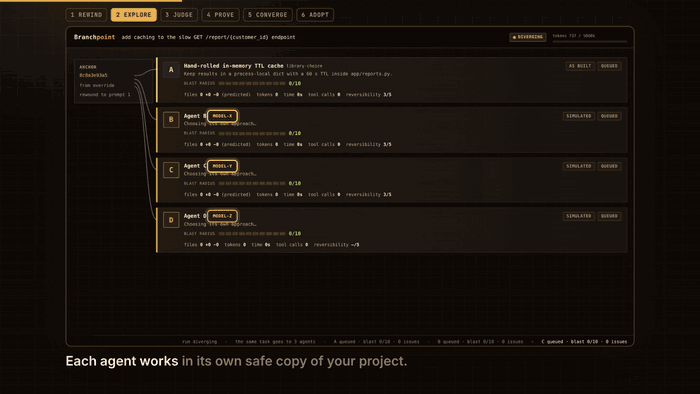

# Branchpoint

**`/rewind` is undo-and-retry. Branchpoint is undo-and-explore.**

Agents commit to the first plausible approach. `/rewind` and `/rollback` let you undo a bad turn, but you only
ever see one alternative at a time, you lose what the abandoned path taught you, and you can't compare routes
side by side. Architecture choices (Redis or in-process cache? trigger or app-level job?) get made on gut feel
and paid for later.

**The idea: give the same task to several agents and let each plan and build it its own way.** Branchpoint takes
any point in a session, hands the task to 2 to 8 agents (default 4: A, B, C, D), each optionally on its **own
model**, and nobody is told how. Every agent states its approach, plans it, and builds it in its own git worktree.
Branchpoint logs every issue, bug and blast-radius impact on the way, then a **blind council** (reviewers and a
judge you can choose) picks one with evidence. Every key decision, and why it was made, goes into a **decision
log**, and **converge** can build one more route from the winner plus the best ideas of the others. Your working
tree is untouched until you say `adopt`.



<sub>The live view replaying a real run on the bundled demo service: three agents on their own models plan and build the
same task, then converge builds a fourth route from the winner and the others' best ideas. The model replies in this
recording are scripted and the model names (`model-x`, `model-y`, `model-z`, `model-j`) are placeholders
(`scripts/offline_demo.py --converge`); the git worktrees, pytest runs, blast tracing, decision log, council code and
merge are the real engine.
[Final frame](docs/multiverse.png) · [Decision Record](docs/decision.png) · [Decision log](docs/decision-log.png)</sub>

## Two ways in

```text
/branchpoint rewind 3                 # "Undo what I've done since prompt 3 and try other ways."
                                      #  What you actually built becomes route A, the baseline.
/branchpoint fork "add caching to GET /report/{id}" --n 4
                                      # "Before we build, explore 4 directions." Every route starts from now.
```

By default (`--approach independent`) agents get **only the task**: they choose their own approach, and if two
agents land on the same idea it is built once and the log says so. With `--approach assigned`, Branchpoint instead
hands each agent a different direction on a distinct axis (library choice, data model, where the logic lives, ...).

Each route is run at one of two fidelities:

| | Simulate | Execute |
|---|---|---|
| What happens | plan + static analysis | a real build in its own worktree, with your tests, lint and type checks |
| Files touched / lines | predicted | actual diff |
| Blast radius | traced statically from the plan | traced on the real diff |
| Bugs hit along the way | predicted risks | failing tests/lint/types (including ones the agent fixed mid-build), retries, blocked actions |
| Cost | estimated | measured when usage is reported; otherwise explicitly estimated |

The default is to **simulate every route, then really build the top 2** (`--execute none|top1|top2|all`).

## Install

```bash
hermes plugins install branchpoint --enable                        # once listed in the catalog
hermes plugins install Sahil-SS9/hermes-branchpoint --enable       # straight from GitHub
```

Needs Hermes `>=0.23.0` (the release that added `/rewind`), `git`, and a git repository to work in. No Python
dependencies. Optional: `ruff`/`mypy`/`npm` are used if your project already has them.

## What a run does

```text
anchor ──► agents ──► plan all ──► build top-k ──► council ──► you decide ──► (converge)
(prompt N   (2-8, own   (each states   (worktree per    (3 blind     adopt merge |    best of all,
 -> commit)  models)     its approach)  route, checks    reviewers +   replay | adr |    judged blind
                                        every 5 calls)  a judge)      discard          with the rest
```

1. **Anchor.** `rewind N` finds the code state at prompt N: Branchpoint's own per-prompt snapshot if the plugin was
   installed, else the Hermes checkpoint taken at that time (overlaid on HEAD), else the last commit before the
   prompt, else `--base <rev>`. The tool tells you which one it used.
2. **Agents.** Each of the N routes gets its own agent and, if you set `--models`, its own model. *Independent*
   mode (default): the agent is told only the task and decides the approach itself. *Assigned* mode: one model
   call proposes N strategies on different *axes* and near-duplicates are rejected and regenerated (see *Honest
   limits*).
3. **Plan.** The agent states its approach, writes a plan and lists the files and symbols it would touch. Branchpoint traces impact
   statically: the import graph (Python via `ast`, JS/TS via a relative-import scan), public API and route
   contracts, schema/migration files, env/config keys, new dependencies.
4. **Build.** A headless Hermes agent builds the approach it planned (or the one it was assigned) with **file tools only**. Branchpoint
   (not the agent) runs your tests, lint and type checks every 5 tool calls and at the end, and feeds the results
   back. Every tool call, duration, error, retry and token count lands in the route's ledger. A build that exits
   nonzero, is stopped at its wall-clock cap, or changes no file is recorded as **failed**, with the process output
   as cited evidence: it is never ranked, never wins, and the Decision Record lists it under "Routes that did not
   finish". Checks that happen to be green do not make an unfinished build a route.
5. **Council.** Three personas (Maintainer, Skeptic, User Advocate) score every ledger **blind** (routes renamed
   R1..Rn in a different random order for each reviewer). Scores are combined in code with fixed weights: goal fit
   30%, correctness 25%, blast radius 20%, simplicity 10%, reversibility 10%, cost 5%. Ties go to the smaller blast
   radius. A judge writes the **Decision Record**, and **every sentence must cite a ledger `evidence_ref`**.
   Refs are checked against the real evidence store; uncited or unresolvable sentences are dropped, never shown.
   You can set the reviewers' model and the judge's model separately (`--reviewer-model`, `--judge-model`).
6. **Converge (optional).** `/branchpoint converge` builds one more route, **Z**, starting from the winner's own
   code, applying the ideas the judge said were worth borrowing from the other routes and reducing the risks it
   flagged. Z is then judged blind, with all the other routes, by the same council and fixed weights, so it has
   to earn its place: it can lose, and the Decision Record says so. Z can be adopted like any route. The first
   verdict is kept as `decision.pre-converge.md`. If converge stops (a refused model, a budget stop, any error), the
   run is marked failed with the reason, the previous verdict is left exactly as it was, and converge can be retried
   once the cause is fixed.

### The decision log

Every run writes `decision-log.md` (and `decision_log.jsonl`): what was decided at each decision point and why, in
plain English, with a short summary at the top. Entries are written by the code that makes the decision, from facts
it already holds (a similarity score, a ranking, a failing check, the agent's own stated plan and risks), so the
"because" is never invented afterwards. It covers where the run started, who works on it (agents, models, judge),
how each agent chose and planned its approach, plans that matched, what got built and what failed, the council's
verdict with the reasons each route lost, converge, and adopt. `/branchpoint log` prints it; it is the **Decision
log** tab in the Decision Record.

### The route ledger

One `ledger.json` per route: strategy, diff stats, files, blast radius `{dependents, public_api, schema, config,
score 0-10}`, issues `{kind: test|lint|type|runtime|retry|predicted, detail, evidence_ref}`, new dependencies,
cost `{tokens, seconds, tool_calls}`, reversibility 1-5, status. Blast score: +2 each for a changed public API, a
schema/migration change, and more than 10 dependents; +1 each for a config change, a new dependency, and 5 or more
files (so the practical maximum is 9).

Evidence refs look like `C:diff:h2` (a diff hunk), `C:test:final` (test output), `C:trace:blast` (the blast trace),
`C:plan:md`, `C:issue:p1`. In the live view and in `decision.md` they open the stored snippet.

## Commands

| | |
|---|---|
| `/branchpoint fork "<goal>" [--n 4] [--execute top2]` | give the same task to several agents before you build |
| `/branchpoint rewind <N> [--goal "…"] [--base <rev>]` | undo-and-explore from prompt N |
| `/branchpoint status [run]` | route tree with blast radius, issues, cost |
| `/branchpoint view [run]` | live multiverse view (loopback only) |
| `/branchpoint council [run]` | (re)run the council |
| `/branchpoint converge [run]` | build the best-of-all route Z from the winner plus the borrowed ideas, judged blind with the rest |
| `/branchpoint log [run]` | the decision log: what was decided at each step, and why |
| `/branchpoint adopt <route> [merge\|replay\|adr\|discard] [--keep]` | land a winner |
| `/branchpoint undo [run]` | reverse an adopt |
| `/branchpoint list`, `abort [run]` | housekeeping |

Options: `--repo <path>` (chat surfaces such as Discord have no working directory of their own; or set `terminal.cwd`),
`--budget 600k` (token budget for the run: refused before the call for Branchpoint's own calls, a per-build cap for
build agents — see *Cost*), `--test-cmd/--lint-cmd/--type-cmd "<cmd>"`,
`--n 2-8` (routes, default 4), `--models a,b,c` (one model per agent, in order; fewer models than agents repeat),
`--judge-model <m>`, `--reviewer-model <m>` (defaults to the judge's), `--approach independent|assigned`,
`--child-model <m>`, `--wait`.

**Adopt.** `merge` makes your working tree equal the winning route's tree by applying a diff from your tree *as it is
now* to the route (one commit if your tree was clean, otherwise left uncommitted for review), keeps a safety snapshot,
runs your tests, and `undo` restores the whole pre-adopt tree (later working-tree edits are replaced, so save them first). `replay` writes the winning plan as a paste-ready prompt (use it after
`/rewind fork N` for a clean conversation; the CLI can't fork a session from plugin code, so Branchpoint doesn't
pretend to). `adr` writes `docs/decisions/NNNN-<slug>.md`. `discard` drops every worktree, branch and ref.
Worktrees are removed after adoption unless `--keep`.

The model can call `branchpoint_fork` (simulate-only, 200k token cap), `branchpoint_status` and
`branchpoint_decision`. Real builds, `rewind` and `adopt` only run from your own slash command.

## Safety and disclosure

* **Routes run in worktrees only.** Each route lives in `<hermes home>/plugin-data/branchpoint/worktrees/<run>/<route>`,
  outside your repository. The build agent has the **file toolset only** (no shell, no network), its starting
  environment carries no YOLO, gateway or approval state, and a `pre_tool_call` hook refuses any path that resolves
  outside its worktree (symlinks and multi-file patches included), any tool outside the file toolset, reads/writes of
  secret-looking files (including symlink aliases), and anything past the tool-call or token budget. Directory content
  searches are refused if the safety scan finds secret-looking files; narrow the search to non-secret files.
* **Builds require the installed hooks.** Before building, a no-model native preflight verifies Branchpoint is enabled
  in the child's Hermes home, tests the confinement decision and checks the installed guard fingerprint. Missing, disabled
  or stale hooks stop the run before a build starts; Branchpoint never installs or enables them silently. Each child must
  also report its own hooks before its model turn. An absent report makes the route fail, even if its tests pass.
  This is plugin-level confinement, not an OS sandbox: only use trusted repositories and check commands.
* **Your working tree is untouched until `adopt`.** What Branchpoint does write into your repo's `.git`: worktree
  metadata (`.git/worktrees/`), route branches `branchpoint/<run>/<route>`, and dangling snapshot commits under
  `refs/branchpoint/`. The per-prompt snapshots (what makes `rewind N` exact) use a throw-away index and never touch
  your index, HEAD or files; switch them off with `anchor_on_turn: false`. `discard` removes everything but the
  ledgers.
* **What is sent to the model** (your configured Hermes model, through `ctx.llm`; Branchpoint makes no other
  network calls): the goal; a condensed transcript before the rewind point (user prompts, 300-character assistant
  replies); a repo map (paths, line counts, top-level symbol names; ignored and secret-looking files excluded);
  excerpts of the files a route would touch (9 KB cap) and, for the baseline, a truncated diff; the ledgers for the
  council. Common credential assignments, bearer strings, provider-key patterns and URL credentials are scrubbed locally
  without private host imports. This is best-effort pattern matching, not proof that arbitrary source text contains no secrets.
  Do not place credentials in goals or source files. The headless build agents see
  the files in their worktree through the file tools, like any Hermes session.
* **Where ledgers are stored:** `<hermes home>/plugin-data/branchpoint/runs/<run-id>/` (`run.json`, `events.jsonl`,
  `routes/<id>/{ledger,evidence}.json`, `plan.md`, `tool_events.jsonl`, `agent.log`, `council/`, `decision.md`) and
  `<hermes home>/plugin-data/branchpoint/anchors/` (prompt snapshots index).
* **Commands it runs:** `git`; your project's own test/lint/type commands, in the worktrees, started by Branchpoint
  exactly as you would start them yourself (this executes your project's code, like `pytest` does); and
  `hermes chat` for the build agents. The live view is an HTTP server on `127.0.0.1` only, with a per-server token and
  a Host-header check.
* **No telemetry, no self-update, no downloads, no stored credentials.**

## Cost

A run is bounded by `--budget` (default 600k tokens). It is spent in two places, and the hard stop works
differently in each:

* **Branchpoint's own model calls** (planning, the council): refused before the call once the budget is used, so
  nothing further is asked of the model. A run cut short this way says so in its warnings and decision log.
* **Build agents**: each build is a separate `hermes chat` process, so it is given a token cap in its route
  marker when it starts — its share of the budget (70% split across the routes), and never more than the run has
  left at that moment. Inside that process, once the cap is reached, Branchpoint refuses its further tool calls
  and tells it to stop. Two limits worth knowing: a build already running finishes the model call it is in
  flight on, and route tokens are counted from the child's own usage reports and charged to the run when the
  route finishes, so the run total is the sum of what the routes reported, not a live cross-process meter. If a
  host reports no usage at all, the per-route tool-call cap is the backstop.

Planning/council calls are small (a 3-route simulate run used about 25k tokens on Haiku 4.5); real builds
dominate. Simulate everything first, build two: that is the point of the default. More routes cost more, and
each model you pick is billed by its own provider. `converge` adds one build and one council round, and raises
the run's budget by `converge_tokens` (default 150k) so it is announced, not hidden.

## Settings

`plugins.entries.branchpoint.settings.*` (also shown in the Desktop settings form): `default_routes` (2-8, default 4),
`models`, `judge_model`, `reviewer_model`, `approach`, `converge_tokens` (extra budget added when you converge),
`execute`,
`budget_tokens`, `max_parallel` (1-3), `route_minutes`, `test_command`, `lint_command`, `type_command`
(`{python}` expands to the project's interpreter; `none` disables), `child_model`, `council_model`, `link_dirs`
(untracked dependency dirs symlinked into worktrees, default `.venv,venv,node_modules`), `anchor_on_turn`.

## Honest limits

* **Diversity is lexical, not semantic.** The plugin API has chat completions but no embeddings, so the spec's
  "embed the theses, reject cosine > 0.88" became: every strategy must sit on its own axis, a TF-IDF similarity
  (thesis + decisions, blended with file overlap) rejects paraphrased duplicates, and a model "same diff, same
  footprint?" check catches the rest. Rejected strategies are shown to you with the reason.
* **Simulated routes are not evidence of correctness.** Their correctness score is capped at 6/10 in code, and the
  Decision Record says which routes were only simulated. Confidence is computed from score margin, reviewer
  agreement and fidelity, not taken from the judge.
* **Blast radius is static.** Python and JS/TS import graphs only; public-API detection understands Python routes and
  exports; a changed contract is recognised from signatures and response/header use, not from behaviour.
* **Converge is a build by one agent, not a code merge.** It starts from the winner's code and is told which ideas to
  borrow; it is not guaranteed to be better, which is why it is judged against everything else and may lose.
* Per-agent and judge models need your Hermes to allow model overrides for the plugin
  (`plugins.entries.branchpoint.llm.allow_model_override`); build agents take `-m` directly. A model you set is
  treated as a decision, not a hint: if Hermes refuses that override for Branchpoint's own calls (planning,
  reviewers, judge), the run stops with an error naming the model and where to grant it. It never falls back to
  another model, since a Decision Record written by a model you did not choose would report something that did
  not happen.
* The token budget is a hard stop for Branchpoint's own model calls and a per-build cap for build agents (see
  *Cost*); it is not a live cross-process meter, so a build already running when the run hits its budget spends
  up to its own cap before it stops.
* Existing failing checks are reported as inherited issues rather than new regressions; a council recommendation is
  not a release approval. Check the cited final test output before adopting, including inherited failures and skips.
* Not covered: repos larger than a single service, runtime/performance benchmarks.
* A build agent is only as good as the model you point it at; the checks are only as good as your tests.
* Hermes cannot fork a session from plugin code today, so `replay` hands you the prompt rather than forking for you.

## Run it without a session

```bash
python demo/prepare_demo.py /tmp/reports-demo            # a tiny FastAPI service with a slow endpoint
cd /tmp/reports-demo && /path/to/hermes-branchpoint/scripts/branchpoint fork "add caching to GET /report/{customer_id}" --n 4
```

`scripts/branchpoint` is the same engine driven by `hermes chat` (state in `~/.local/state/hermes-branchpoint`).
Real builds require this version of Branchpoint installed and enabled in the same Hermes home used by the child;
merely running the script from a checkout does not load its hooks. The preflight refuses that case and names the
installation/enablement commands. `--execute none` remains available without child hooks. Standalone planning
and council chats expose only Hermes' session-local TODO bookkeeping tool, not file, shell, web or delegation tools;
the classic CLI cannot select a truly empty toolset. JSON-only prompts request no tool calls.
The demo service (`demo/service`, FastAPI + pytest, tests run in milliseconds) and `demo/baseline_ttl` (the
hand-rolled cache you'd write first; use `--built` for the retrospective demo) are included so you can re-run it.

## Development

```bash
python -m pytest                     # offline suite (CI: Linux + macOS, Python 3.11 and 3.13)
python -m pytest tests/e2e -m e2e    # needs a real Hermes host: plugin load, slash command, child build agent
                                     # (scripted model, no credentials, ~1 min; not run in CI)
hermes plugins validate .            # the catalog admission gate
```

The offline suite is what CI proves on both platforms. The e2e suite is the only test that exercises a real
Hermes session and a real `hermes chat` child, so "green CI" means the engine works, not that the plugin has
been run inside a host on that platform.

MIT licensed. Design notes, the resolved open questions and every deviation from the PRD: [`docs/SPEC.md`](docs/SPEC.md).
