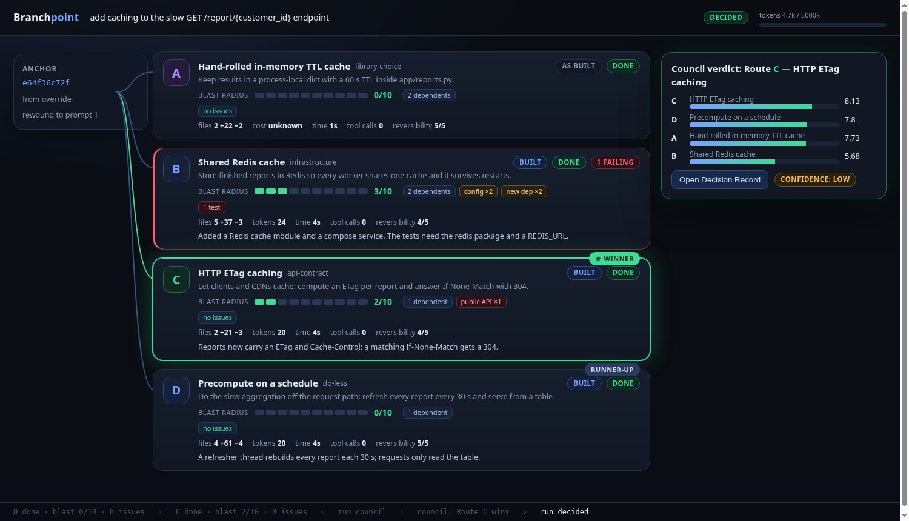

# Branchpoint

**`/rewind` is undo-and-retry. Branchpoint is undo-and-explore.**

Agents commit to the first plausible approach. `/rewind` and `/rollback` let you undo a bad turn, but you only
ever see one alternative at a time, you lose what the abandoned path taught you, and you can't compare routes
side by side. Architecture choices (Redis or in-process cache? trigger or app-level job?) get made on gut feel
and paid for later.

Branchpoint takes any point in a session and explores **3 to 5 genuinely different ways to build it**, each in
its own git worktree, logs every issue, bug and blast-radius impact on the way, then lets a **blind council**
pick one with evidence. Your working tree is untouched until you say `adopt`.



## Two ways in

```text
/branchpoint rewind 3                 # "Undo what I've done since prompt 3 and try other ways."
                                      #  What you actually built becomes route A, the baseline.
/branchpoint fork "add caching to GET /report/{id}" --n 4
                                      # "Before we build, explore 4 directions." Every route starts from now.
```

Each route is run at one of two fidelities:

| | Simulate | Execute |
|---|---|---|
| What happens | plan + static analysis | a real build in its own worktree, with your tests, lint and type checks |
| Files touched / lines | predicted | actual diff |
| Blast radius | traced statically from the plan | traced on the real diff |
| Bugs hit along the way | predicted risks | failing tests/lint/types (including ones the agent fixed mid-build), retries, blocked actions |
| Cost | estimated | measured |

The default is to **simulate every route, then really build the top 2** (`--execute none|top1|top2|all`).

## Install

```bash
hermes plugins install Sahil-SS9/hermes-branchpoint --enable
```

Needs Hermes `>=0.23.0` (the release that added `/rewind`), `git`, and a git repository to work in. No Python
dependencies. Optional: `ruff`/`mypy`/`npm` are used if your project already has them.

## What a run does

```text
anchor ──► diverge ──► simulate all ──► build top-k ──► council ──► you decide
(prompt N   (N routes,   (plan + static   (worktree per    (3 blind     adopt merge |
 -> commit)  diversity     blast radius)    route, checks    reviewers +   replay | adr |
             checked)                       every 5 calls)  a judge)      discard
```

1. **Anchor.** `rewind N` finds the code state at prompt N: Branchpoint's own per-prompt snapshot if the plugin was
   installed, else the Hermes checkpoint taken at that time (overlaid on HEAD), else the last commit before the
   prompt, else `--base <rev>`. The tool tells you which one it used.
2. **Diverge.** One model call proposes N strategies, each on a different *axis* (library choice, data model, where
   the logic lives, sync vs async, do-less, infrastructure, API contract). Near-duplicates are rejected and
   regenerated (see *Honest limits* for how).
3. **Simulate.** The agent writes a plan and lists the files and symbols it would touch. Branchpoint traces impact
   statically: the import graph (Python via `ast`, JS/TS via a relative-import scan), public API and route
   contracts, schema/migration files, env/config keys, new dependencies.
4. **Build.** A headless Hermes agent gets the strategy as a hard constraint and **file tools only**. Branchpoint
   (not the agent) runs your tests, lint and type checks every 5 tool calls and at the end, and feeds the results
   back. Every tool call, duration, error, retry and token count lands in the route's ledger.
5. **Council.** Three personas (Maintainer, Skeptic, User Advocate) score every ledger **blind** (routes renamed
   R1..Rn in a different random order for each reviewer). Scores are combined in code with fixed weights: goal fit
   30%, correctness 25%, blast radius 20%, simplicity 10%, reversibility 10%, cost 5%. Ties go to the smaller blast
   radius. A judge writes the **Decision Record**, and **every sentence must cite a ledger `evidence_ref`**.
   Refs are checked against the real evidence store; uncited or unresolvable sentences are dropped, never shown.

### The route ledger

One `ledger.json` per route: strategy, diff stats, files, blast radius `{dependents, public_api, schema, config,
score 0-10}`, issues `{kind: test|lint|type|runtime|retry|predicted, detail, evidence_ref}`, new dependencies,
cost `{tokens, seconds, tool_calls}`, reversibility 1-5, status. Blast score: +2 each for a changed public API, a
schema/migration change, and more than 10 dependents; +1 each for a config change, a new dependency, and 5 or more
files (so the practical maximum is 9).

Evidence refs look like `C:diff:h2` (a diff hunk), `C:test:final` (test output), `C:trace:blast` (the blast trace),
`C:plan:md`, `C:issue:p1`. In the live view and in `decision.md` they open the stored snippet.

## Commands

| | |
|---|---|
| `/branchpoint fork "<goal>" [--n 4] [--execute top2]` | explore before you build |
| `/branchpoint rewind <N> [--goal "…"] [--base <rev>]` | undo-and-explore from prompt N |
| `/branchpoint status [run]` | route tree with blast radius, issues, cost |
| `/branchpoint view [run]` | live multiverse view (loopback only) |
| `/branchpoint council [run]` | (re)run the council |
| `/branchpoint adopt <route> [merge\|replay\|adr\|discard] [--keep]` | land a winner |
| `/branchpoint undo [run]` | reverse an adopt |
| `/branchpoint list`, `abort [run]` | housekeeping |

Options: `--budget 600k` (token hard stop for the whole run), `--test-cmd/--lint-cmd/--type-cmd "<cmd>"`,
`--models a,b,c` (a different model per route), `--child-model <m>`, `--wait`.

**Adopt.** `merge` makes your working tree equal the winning route's tree by applying a diff from your tree *as it is
now* to the route (one commit if your tree was clean, otherwise left uncommitted for review), keeps a safety snapshot,
runs your tests, and `undo` reverses it. `replay` writes the winning plan as a paste-ready prompt (use it after
`/rewind fork N` for a clean conversation; the CLI can't fork a session from plugin code, so Branchpoint doesn't
pretend to). `adr` writes `docs/decisions/NNNN-<slug>.md`. `discard` drops every worktree, branch and ref.
Worktrees are removed after adoption unless `--keep`.

The model can call `branchpoint_fork` (simulate-only, 200k token cap), `branchpoint_status` and
`branchpoint_decision`. Real builds, `rewind` and `adopt` only run from your own slash command.

## Safety and disclosure

* **Routes run in worktrees only.** Each route lives in `<hermes home>/plugin-data/branchpoint/worktrees/<run>/<route>`,
  outside your repository. The build agent has the **file toolset only** (no shell, no network), its starting
  environment carries no YOLO, gateway or approval state, and a `pre_tool_call` hook refuses any path that resolves
  outside its worktree (symlinks and multi-file patches included), any tool outside the file toolset, secret-looking
  files, and anything past the tool-call or token budget.
* **Your working tree is untouched until `adopt`.** What Branchpoint does write into your repo's `.git`: worktree
  metadata (`.git/worktrees/`), route branches `branchpoint/<run>/<route>`, and dangling snapshot commits under
  `refs/branchpoint/`. The per-prompt snapshots (what makes `rewind N` exact) use a throw-away index and never touch
  your index, HEAD or files; switch them off with `anchor_on_turn: false`. `discard` removes everything but the
  ledgers.
* **What is sent to the model** (your configured Hermes model, through `ctx.llm`; Branchpoint makes no other
  network calls): the goal; a condensed transcript before the rewind point (user prompts, 300-character assistant
  replies); a repo map (paths, line counts, top-level symbol names; ignored and secret-looking files excluded);
  excerpts of the files a route would touch (9 KB cap) and, for the baseline, a truncated diff; the ledgers for the
  council. Text is passed through Hermes' secret redactor when the host provides it. The headless build agents see
  the files in their worktree through the file tools, like any Hermes session.
* **Where ledgers are stored:** `<hermes home>/plugin-data/branchpoint/runs/<run-id>/` (`run.json`, `events.jsonl`,
  `routes/<id>/{ledger,evidence}.json`, `plan.md`, `tool_events.jsonl`, `agent.log`, `council/`, `decision.md`) and
  `<hermes home>/plugin-data/branchpoint/anchors/` (prompt snapshots index).
* **Commands it runs:** `git`; your project's own test/lint/type commands, in the worktrees, started by Branchpoint
  exactly as you would start them yourself (this executes your project's code, like `pytest` does); and
  `hermes chat` for the build agents. The live view is an HTTP server on `127.0.0.1` only, with a per-server token and
  a Host-header check.
* **No telemetry, no self-update, no downloads, no stored credentials.**

## Cost

A run is bounded by `--budget` (default 600k tokens, hard stop: an exhausted budget stops further model calls and
refuses further build-agent tool calls). Planning/council calls are small (a 3-route simulate run used about 25k
tokens on Haiku 4.5); real builds dominate. Simulate everything first, build two: that is the point of the default.

## Settings

`plugins.entries.branchpoint.settings.*` (also shown in the Desktop settings form): `default_routes`, `execute`,
`budget_tokens`, `max_parallel` (1-3), `route_minutes`, `test_command`, `lint_command`, `type_command`
(`{python}` expands to the project's interpreter; `none` disables), `child_model`, `council_model`, `link_dirs`
(untracked dependency dirs symlinked into worktrees, default `.venv,venv,node_modules`), `anchor_on_turn`.

## Honest limits

* **Diversity is lexical, not semantic.** The plugin API has chat completions but no embeddings, so the spec's
  "embed the theses, reject cosine > 0.88" became: every strategy must sit on its own axis, a TF-IDF similarity
  (thesis + decisions, blended with file overlap) rejects paraphrased duplicates, and a model "same diff, same
  footprint?" check catches the rest. Rejected strategies are shown to you with the reason.
* **Simulated routes are not evidence of correctness.** Their correctness score is capped at 6/10 in code, and the
  Decision Record says which routes were only simulated. Confidence is computed from score margin, reviewer
  agreement and fidelity, not taken from the judge.
* **Blast radius is static.** Python and JS/TS import graphs only; public-API detection understands Python routes and
  exports; a changed contract is recognised from signatures and response/header use, not from behaviour.
* Not covered: automatically merging two routes, repos larger than a single service, runtime/performance benchmarks.
* A build agent is only as good as the model you point it at; the checks are only as good as your tests.
* Hermes cannot fork a session from plugin code today, so `replay` hands you the prompt rather than forking for you.

## Run it without a session

```bash
python demo/prepare_demo.py /tmp/reports-demo            # a tiny FastAPI service with a slow endpoint
cd /tmp/reports-demo && /path/to/hermes-branchpoint/scripts/branchpoint fork "add caching to GET /report/{customer_id}" --n 4
```

`scripts/branchpoint` is the same engine driven by `hermes chat` (state in `~/.local/state/hermes-branchpoint`).
The demo service (`demo/service`, FastAPI + pytest, tests run in milliseconds) and `demo/baseline_ttl` (the
hand-rolled cache you'd write first; use `--built` for the retrospective demo) are included so you can re-run it.

## Development

```bash
python -m pytest                     # 59 offline tests: pipeline, council, blast tracer, hooks, server, packaging
python -m pytest tests/e2e -m e2e    # real `hermes chat` child process, scripted model (no credentials)
hermes plugins validate .            # the catalog admission gate
```

MIT licensed. The spec this implements is in `docs/SPEC.md`.
